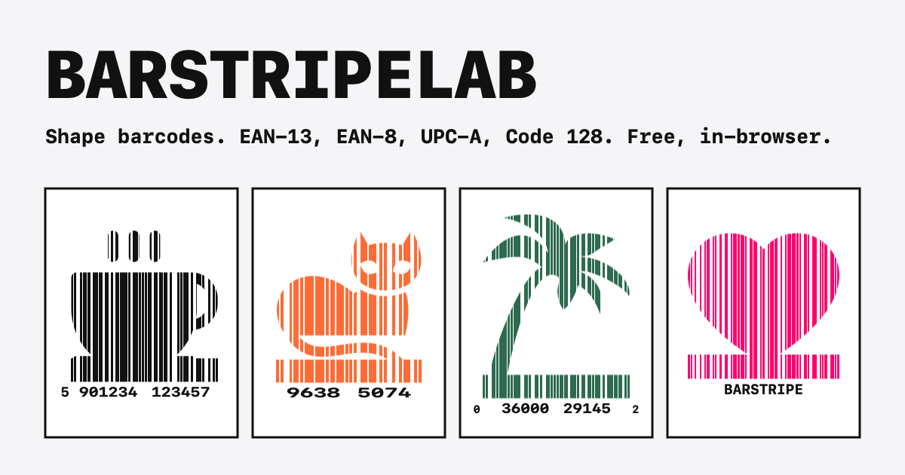

# BarStripeLab

BarStripeLab makes EAN-13, EAN-8, UPC-A and Code 128 barcodes with a scan-safety estimate and a decode check, so you can look before you print. The twist is the shape: the bars can be cut into one of 46 silhouettes, such as a coffee cup, a cat or a palm tree.

It is free, has no account and runs entirely in your browser.

**Live:** https://barstripelab.sudarshantechlabs.com



## How it works

The generator is one four-step flow:

1. **Number.** Type the number. The check digit is checked as you type, and the format is detected. You can choose the format yourself.
2. **Where it will be scanned.** Shops or Amazon (Retail-safe), or phones and looks (Art). Then choose the size.
3. **Shape.** Pick one of the 46 shapes, a colour preset or a template. Or describe a style to the AI generator.
4. **Result.** The barcode on a product panel (coffee bag, can, snack box or swing tag), with the scan check, the decode check and the downloads.

Press `/`, or use **All settings** in the header, to open every setting in one sheet.

Every shape has its own page at `/shape/<id>`. There is also a [barcode tattoo page](https://barstripelab.sudarshantechlabs.com/barcode-tattoo), which opens in Art mode.

## Formats

- **EAN-13 and UPC-A**: digits only. Leave off the check digit and it is added: 12 digits for EAN-13, 11 for UPC-A.
- **EAN-8**: 7 or 8 digits.
- **Code 128**: letters, numbers, spaces and symbols (printable ASCII), up to 48 characters. Accents and emoji are refused.

EAN-13, EAN-8 and UPC-A print from 80% to 200% of the standard size (module width X = 0.330 mm at 100%). Code 128 module width is 0.19 mm to 1.00 mm. Bar width reduction, from 0 to 0.10 mm, makes the bars thinner to allow for ink spread. Ask your printer what to set.

## Scan safety

- **Retail-safe** (the default): every bar keeps full height along the bottom band, and the shape sits above it. Use it for shops and Amazon.
- **Art**: the shape gets more room, and the bars are shorter. Phones read them. Strict checkout scanners may not.
- **Quiet zones**: blank margins on both sides, at least the minimum for the format (GS1 for EAN and UPC, ISO/IEC 15417 for Code 128). Keep them clear when you place the artwork.
- **Scan check**: a 0 to 100 estimate from the design. It weighs red-light contrast, bar height, quiet zones, print size, digits and camera contrast. 80 and above is "likely fine", 50 to 79 is "risky", and below 50 is "likely to fail". A colour that looks white to red-laser scanners caps the score at 20.
- **Decode check**: the app draws the barcode and decodes it in your browser. The result must equal your number.
- **Phone-read check**: for shaped barcodes, the app also reads the artwork with ZXing, the engine inside many phone scanner apps, with every barcode type switched on. A scan line through the shape can hold a shorter valid code, so if ZXing reads a different number, a warning shows it.
- **Contrast warnings**: a warning appears when the bars are too pale to scan, and another when the colour is red, orange or pink.

Honest limits:

- The scan check is an estimate from the design. It is not a GS1 verification. GS1 does not endorse decorated barcodes.
- The red-light check uses screen colours as a stand-in for printed ink. It is not a print test.
- The decode check reads your browser's rendering, not a checkout scanner.
- The phone-read check runs ZXing on your browser's rendering. Real phone apps use their own cameras and settings, so it catches likely misreads but cannot rule them all out.
- Print one copy at the real size, on the real material, and scan it with the scanners your customers and shops use, before a full run.
- Retailers expect numbers licensed to your company by GS1. BarStripeLab draws the digits you enter. It cannot issue or register a number.

## Exports

- **SVG**: vector artwork. Its width and height are set in millimetres, so it opens at the printed size. You can also copy the SVG to the clipboard.
- **PDF**: the same artwork at the printed size.
- **PNG**: 150, 300 or 600 dpi (300 by default). The file records its dpi, so print apps use it.
- **Spec sheet PDF**: the design, the scan check and the sizes, for your printer. It is an estimate, not a verification.
- **Many barcodes**: paste a list, or a CSV (the first column). Up to 500 numbers are used. You get a ZIP with one SVG per number, and a PDF per number if you tick the box.
- **Share links**: the address bar always holds the whole design, so the link reproduces the exact barcode.

Keyboard shortcuts, held with Option (Alt): S changes the shape, C changes the colour preset, D downloads the SVG, P downloads the PNG, and H shares.

## Privacy and the AI generator

The barcode is drawn in your browser. The source has no analytics code. The site is served by Cloudflare Pages, which handles the page requests.

The last design is kept in your browser's local storage, so "Continue where you left off" works. Clear the site's data to remove it.

The AI generator is optional. It asks Claude (`claude-opus-5-5`) to suggest a shape and a colour from a short description. Paste your own Anthropic API key. The key stays in the page's memory and is never stored. The key and your description go only to api.anthropic.com, and each request is billed to your Anthropic account. Everything else works without a key.

## Shapes and licenses

The shape artwork comes from [Phosphor Icons](https://phosphoricons.com) (MIT) and [game-icons.net](https://game-icons.net) (CC BY 3.0). The phone-read check uses [ZXing](https://github.com/zxing-js/library) (Apache-2.0). The full licenses, credits and the changes made to each game-icons.net shape are in [THIRD_PARTY_NOTICES.md](THIRD_PARTY_NOTICES.md). The app code is MIT, see [LICENSE](LICENSE).

## Development

Requires Node 20.19.6 (see `.nvmrc`) and pnpm.

```bash
pnpm install
pnpm dev          # http://localhost:3000
pnpm test         # vitest
pnpm typecheck    # tsc --noEmit
pnpm lint         # next lint
pnpm build        # static export to out/
```

No environment variables are needed. `.env.example` documents the one optional setting, `BASE_PATH`, for serving the export from a sub-path.

See [CONTRIBUTING.md](CONTRIBUTING.md) for how to add a shape or a template.

## Deployment

The site is a Next.js static export (`output: "export"`). Cloudflare Pages builds it from the `main` branch with:

- Build command: `pnpm build`
- Build output directory: `out`
- Node version: `20.19.6`

The Cloudflare Pages settings are in the Cloudflare dashboard, not in this repo.

`public/_headers` sets the security headers, including the Content-Security-Policy, and long-lived caching for `/_next/static/*`. The sitemap (`/sitemap.xml`) and `robots.txt` are generated at build time.

---

## About

I'm Sudarshan Chaudhari, a Senior Quality Engineer, Test Automation specialist, and AI systems builder based in Bangkok, Thailand.

I have 13+ years of experience in software quality engineering, working across SaaS, fintech, gaming, web, mobile, cloud, and digital signage platforms. My background combines hands-on test automation with QA leadership, test strategy, CI/CD, release quality, production investigation, and cross-platform validation.

Alongside my professional QA career, I run [SudarshanTechLabs](https://sudarshantechlabs.com/), my independent engineering and product lab where I design, build, test, and ship software across Android, web, AI, cybersecurity, developer tooling, and cross-platform applications.

### What I work on

- ⚙️ **Quality Engineering & Test Automation** — Playwright, Selenium, Cypress, Appium, API testing, automation frameworks, end-to-end testing, CI/CD, release gates, GitHub Actions, risk-based testing, and production validation
- 🤖 **AI Systems & Automation** — AI agents, multi-agent orchestration, MCP servers, AI-assisted QA, prompt tooling, developer workflows, automation systems, and Claude Code plugins
- 📱 **Mobile & Cross-Platform Applications** — Android applications built with Kotlin and Jetpack Compose, Google Play releases, automated build and publishing pipelines, and cross-platform development spanning iOS, web, Windows, and macOS
- 🌐 **Web Applications & Platforms** — Full-stack applications using Next.js, TypeScript, Firebase, Cloudflare, REST APIs, and modern web infrastructure
- 🛠️ **Developer Tooling & CLI Engineering** — Rust, Python, TypeScript, CLI utilities, multi-repository tooling, build automation, release tooling, and engineering productivity systems
- 🛡️ **Cybersecurity & Observability** — Threat detection, log analysis, security auditing, vulnerability assessment, monitoring, and security-focused developer tools
- 📺 **Digital Signage & Device Platforms** — Content validation, playback testing, device compatibility, production investigation, monitoring, and QA across diverse hardware and operating-system environments

My work sits at the intersection of quality engineering, automation, AI, and software development. I approach products with a QA mindset from the beginning: understanding failure modes, designing for testability, automating repetitive work, and building release confidence into the engineering process.

Through SudarshanTechLabs, I also build products and tools from idea to production, covering architecture, development, testing, CI/CD, release automation, monitoring, and ongoing maintenance.

🌐 [sudarshantechlabs.com](https://sudarshantechlabs.com/) · 💼 [LinkedIn](https://linkedin.com/in/sudarshan-chaudhari) · 🐙 [GitHub](https://github.com/SUDARSHANCHAUDHARI) · ✉️ [sunny.sudarshan@gmail.com](mailto:sunny.sudarshan@gmail.com)
